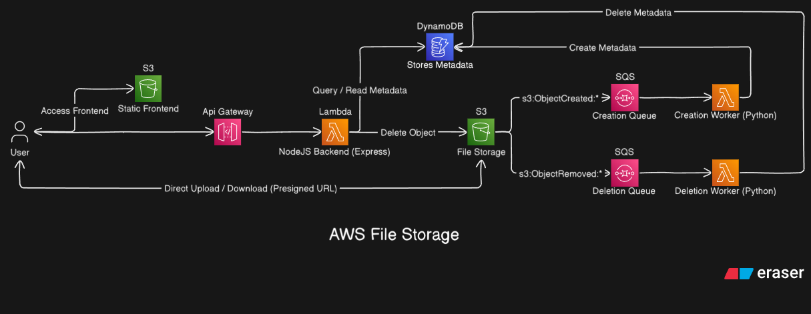

# Serverless File Storage on AWS

A full-stack serverless file storage application built on AWS. Users upload and download files directly to/from Amazon S3 using presigned URLs, while an event-driven pipeline (S3 Event Notifications → Amazon SQS → Python Lambda Workers) asynchronously syncs file metadata to Amazon DynamoDB. All infrastructure is provisioned with Terraform.

## Architecture



### How It Works

1. **Static Frontend (`Frontend/`)**: A React + TypeScript + Vite single-page application hosted on an **S3 Static Website** bucket. On load, it assigns/reads a persistent anonymous `userId` in `localStorage`.
2. **API Layer (`Backend/`)**: An **Express 5** API (wrapped with `serverless-http`) running on **AWS Lambda (Node.js 24, `arm64`)** behind **Amazon API Gateway (HTTP API v2)**.
   - Generates **S3 presigned `PUT` and `GET` URLs** locally using `@aws-sdk/s3-request-presigner`.
   - Queries **DynamoDB** (`drive-files-metadata`) to list a user's uploaded files.
   - Deletes objects from **S3** via `DeleteObjectCommand`.
3. **Direct Client ↔ S3 Transfers**: The browser uploads (`PUT` with `XMLHttpRequest` progress tracking) and downloads (`GET`) files directly with the **S3 File Storage** bucket using the presigned URLs—avoiding Lambda payload limits.
4. **Async Metadata Pipeline (`Metadata-Processor-Creation/` & `Metadata-Processor-Deletion/`)**:
   - **Creation**: S3 emits `s3:ObjectCreated:*` events to the **Creation SQS Queue**, triggering the **Creation Worker (Python 3.13, `arm64`)** via an SQS Event Source Mapping (`batch_size = 5`, `ReportBatchItemFailures`). It extracts object details (`user_id`, `file_name`, `s3_key`, `file_size`, `content_type`, timestamps) and writes the record to DynamoDB.
   - **Deletion**: S3 emits `s3:ObjectRemoved:*` events to the **Deletion SQS Queue**, triggering the **Deletion Worker (Python 3.13, `arm64`)** to query DynamoDB for matching `user_id` + `s3_key` items and delete them.

---

## Tech Stack

| Layer | Technology |
| :--- | :--- |
| **Frontend** | React 19, TypeScript, Vite 8, `lucide-react` |
| **Backend API** | Node.js 24 (`arm64`), Express 5, `serverless-http`, AWS SDK v3 (`@aws-sdk/client-s3`, `@aws-sdk/s3-request-presigner`, `@aws-sdk/client-dynamodb`, `@aws-sdk/lib-dynamodb`) |
| **Metadata Workers** | Python 3.13 (`arm64`), `boto3` |
| **AWS Services** | S3 (Frontend Hosting & File Storage), API Gateway (HTTP API), Lambda, SQS, DynamoDB, CloudWatch Logs *(optional CloudFront OAC module included in Terraform)* |
| **Infrastructure as Code** | Terraform (AWS Provider `6.70.0`, S3 remote state backend) |

---

## Project Structure

```text
.
├── Diagram.png                         # Architecture diagram
├── Frontend/                           # React + Vite frontend
│   ├── src/
│   │   ├── App.tsx                     # Main UI (drag-and-drop upload, file list, search, actions)
│   │   └── services/storage.ts         # API client & direct S3 XHR upload helper
│   └── package.json
├── Backend/                            # Express + Lambda API (TypeScript)
│   ├── src/
│   │   ├── index.ts                    # Express routes & serverless-http handler
│   │   ├── s3.ts                       # Presigned URL generation & S3 delete
│   │   └── dynamodb.ts                 # DynamoDB query helper
│   └── package.json
├── Metadata-Processor-Creation/        # Python Lambda for s3:ObjectCreated:* SQS events
│   └── main.py
├── Metadata-Processor-Deletion/        # Python Lambda for s3:ObjectRemoved:* SQS events
│   └── main.py
└── Terraform/                          # Modular Terraform configuration
    ├── main.tf
    ├── variables.tf
    ├── outputs.tf
    ├── providers.tf
    ├── backend.tf
    └── modules/
        ├── apigateway/
        ├── cloudfront/                 # Optional CloudFront + OAC module (commented out in main.tf)
        ├── dynamodb/
        ├── file_storage_s3_bucket/
        ├── frontend_s3_bucket/
        ├── lambda_backend/
        ├── lambda_metadata_processor/
        └── sqs/
```

---

## API Endpoints

| Method | Endpoint | Description |
| :--- | :--- | :--- |
| `GET` | `/` or `/home` | API metadata and available endpoints |
| `GET` | `/health` | Health check (`status`, `uptime`, `timestamp`) |
| `GET` | `/api/config` | Returns configured S3 bucket name, region, and credential status |
| `GET` | `/api/files?userId=<id>` | Lists file metadata for a user from DynamoDB |
| `POST` | `/api/files/upload-url` | Generates a presigned S3 `PUT` URL (`{ fileName, fileType, userId? }`) |
| `GET` / `POST` | `/api/files/download-url` | Generates a presigned S3 `GET` URL (`key`, optional `originalName`) |
| `DELETE` | `/api/files` | Deletes an object from S3 (`key` via query or JSON body) |

---

## Deployment (Terraform)

### Prerequisites

- [Terraform](https://developer.hashicorp.com/terraform/downloads)
- [AWS CLI](https://aws.amazon.com/cli/) configured with your profile (default in [Terraform/variables.tf](Terraform/variables.tf): `pa-abhradip`, region `ap-south-1`)
- [Node.js](https://nodejs.org/) & `pnpm` (or `npm`) — Terraform's `frontend_s3_bucket` module builds `Frontend/` and syncs `dist/` to S3 via `local-exec`

> **Note:** [Terraform/backend.tf](Terraform/backend.tf) configures an S3 remote state backend (`pa.abhradip-terraform-bucket`). Update `backend.tf` and `variables.tf` (`aws_profile`, bucket names, etc.) to match your AWS account before applying.

### Steps

1. **Build the Backend Lambda bundle**:
   ```bash
   cd Backend
   pnpm install
   pnpm build
   ```

2. **Initialize and apply Terraform**:
   ```bash
   cd ../Terraform
   terraform init
   terraform plan
   terraform apply
   ```

3. **Outputs**: After `terraform apply`, Terraform outputs `frontend_website_url`, `api_gateway_endpoint`, `lambda_backend_function_url`, S3 bucket names, SQS queue URLs, and DynamoDB table details.

---

## Local Development

### Backend

```bash
cd Backend
pnpm install
# Configure AWS_REGION, FILE_STORAGE_BUCKET_NAME, DYNAMODB_TABLE_NAME, and AWS credentials in .env
pnpm dev
```

The Express server starts locally on `http://localhost:5000` (or `PORT` from `.env`).

### Frontend

```bash
cd Frontend
pnpm install
# Set VITE_API_URL=http://localhost:5000 (or your API Gateway endpoint) in .env
pnpm dev
```
